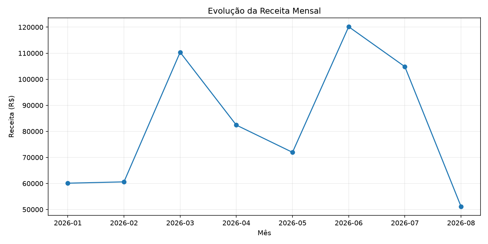
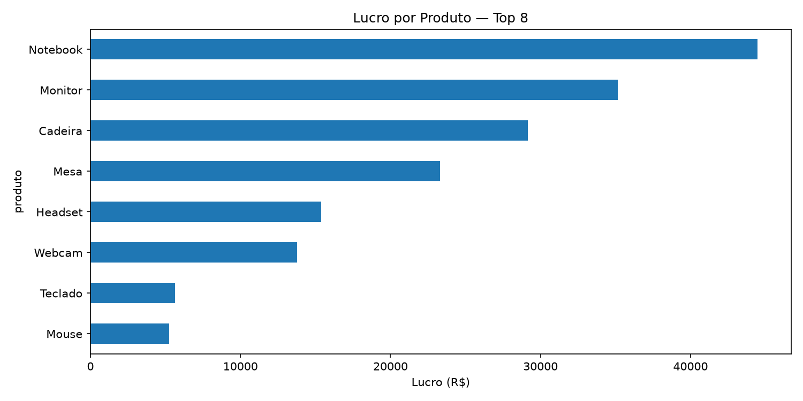

<!-- BANNER -->
<p align="center">
  
</p>

<h1 align="center">Análise Financeira com Python</h1>

<p align="center">
  Análise de dados de vendas para geração de indicadores financeiros,
  identificação de resultados e apoio à tomada de decisões.
</p>

<p align="center">
  
  
  
</p>

---

## 📌 Sobre o projeto

Este projeto utiliza Python para realizar uma análise financeira a partir de uma base fictícia de vendas.

A proposta é transformar registros de vendas em informações relevantes para o negócio, utilizando manipulação de dados, cálculos de indicadores e visualizações gráficas.

O projeto demonstra como a análise de dados pode contribuir para compreender resultados financeiros, acompanhar a evolução das receitas e identificar produtos e clientes com maior participação nos resultados.

## 🎯 Objetivos

- Organizar e analisar dados de vendas.
- Calcular indicadores financeiros.
- Acompanhar a evolução mensal da receita.
- Identificar os produtos com maior geração de lucro.
- Analisar os clientes com maior receita.
- Apresentar os resultados por meio de gráficos.

---

## 📊 Indicadores e análises

### Indicadores financeiros

- **Receita total:** soma dos valores de vendas.
- **Custos totais:** soma dos custos registrados.
- **Lucro total:** resultado financeiro das vendas.
- **Margem de lucro:** relação entre lucro e receita.

### Análise temporal

- Agrupamento dos dados por mês.
- Acompanhamento da evolução da receita.
- Comparação mensal entre receita, custos e lucro.

### Análise de desempenho

- Ranking dos produtos com maior lucro.
- Identificação dos principais clientes por receita.
- Comparação dos resultados entre produtos e clientes.

---

## 📈 Visualizações geradas

O script gera gráficos automaticamente e salva os arquivos na pasta `outputs/`.

### Evolução da receita mensal

Gráfico de linha utilizado para acompanhar o comportamento da receita ao longo dos meses.



### Lucro por produto

Gráfico de barras horizontais para visualizar os produtos com maior geração de lucro.



---

## 🛠️ Tecnologias utilizadas

| Tecnologia | Aplicação |
|---|---|
| Python | Desenvolvimento da análise |
| Pandas | Manipulação, agrupamento e análise dos dados |
| Matplotlib | Criação de gráficos e visualizações |

---

## 🗂️ Estrutura do projeto

```text
analise-financeira-python/
│
├── data/
│   └── vendas.csv
│
├── outputs/
│   ├── receita_mensal.png
│   └── lucro_produtos.png
│
├── src/
│   └── analise.py
│
├── requirements.txt
└── README.md
```

---

## 🚀 Como executar o projeto

### 1. Clone o repositório

```bash
git clone https://github.com/Felip-Git/analise-financeira-python.git
```

### 2. Acesse a pasta

```bash
cd analise-financeira-python
```

### 3. Crie um ambiente virtual

```bash
python -m venv venv
```

No Windows, ative com:

```bash
venv\Scripts\activate
```

### 4. Instale as dependências

```bash
pip install -r requirements.txt
```

### 5. Execute a análise

```bash
python src/analise.py
```

Os indicadores serão apresentados no terminal e os gráficos serão gerados na pasta `outputs/`.

---

## 💡 Aprendizados e aplicações

Este projeto permitiu aplicar conceitos importantes de análise de dados com Python:

- Leitura e manipulação de arquivos CSV.
- Tratamento e organização de dados com Pandas.
- Agrupamento de informações por períodos e categorias.
- Criação de indicadores financeiros.
- Ordenação e classificação de resultados.
- Visualização de dados com Matplotlib.
- Interpretação de informações para apoiar decisões.

---

## 📌 Sobre os dados

A base utilizada contém dados fictícios de vendas, desenvolvidos exclusivamente para fins de estudo e demonstração.

Os resultados não representam informações financeiras de uma empresa real.

---

## 👨‍💻 Desenvolvedor

**Felipe Martins**

Estudante de Análise e Desenvolvimento de Sistemas no IFSul, com interesse em Análise de Dados, Python, SQL e automação de processos.

<p align="left">
  <a href="https://www.linkedin.com/in/felipe-martins-b62714237/">
    
  </a>
  <a href="https://github.com/Felip-Git">
    
  </a>
</p>

<p align="center">
  Desenvolvido com Python e foco em transformar dados em informação.
</p>

<p align="center">
  
</p>
